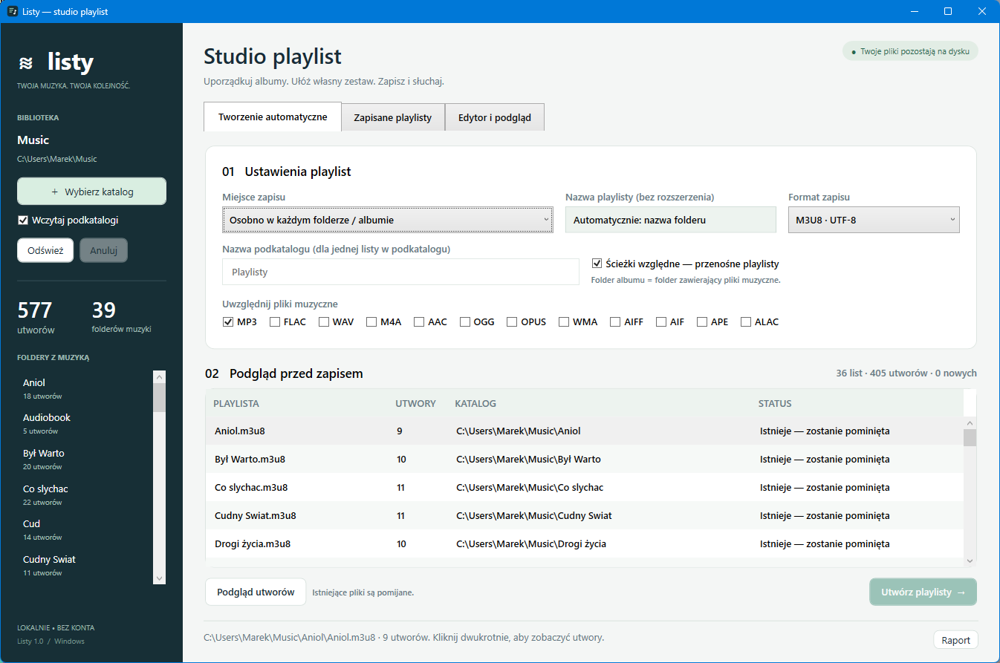

# Listy — studio playlist

Lokalna aplikacja Windows do automatycznego i ręcznego tworzenia playlist. **Polski / English** · [English documentation](README.en.md)

[**Pobierz Listy.exe — Windows x64**](https://github.com/zetmar-collab/Listy/releases/latest/download/Listy.exe) · [Wydania](https://github.com/zetmar-collab/Listy/releases) · [MIT](LICENSE)

## Uruchomienie

Pobierz i otwórz **Listy.exe**. Wersja przenośna Windows x64 zawiera środowisko .NET, nie wymaga instalatora, konta ani serwera. Pierwszy start rozpakowuje biblioteki do katalogu tymczasowego .NET. EXE nie ma podpisu cyfrowego.

Suma kontrolna znajduje się w **SHA256SUMS.txt** w wydaniu. Sprawdzenie:

~~~powershell
Get-FileHash .\Listy.exe -Algorithm SHA256
~~~

## Tworzenie automatyczne

1. Kliknij **Wybierz katalog**. Opcje **Wczytaj podkatalogi** i **Odczytuj tagi i czas utworów** stosowane są przy skanowaniu; po ich zmianie kliknij **Odśwież**.
2. Zaznacz checkboxy albumów, które chcesz przetworzyć. Przyciski **Wszystkie / Żaden** dotyczą albumów widocznych po zastosowaniu wyszukiwarki. Podgląd albumu otworzysz dwuklikiem.
3. Wybierz lokalizację:
   - **Osobno w każdym folderze / albumie** — nazwa listy pochodzi z folderu, np. Album Jazz/Album Jazz.m3u8. Foldery CD 1 i CD 2 mają osobne listy.
   - **Jedna lista w katalogu głównym** — utwory z zaznaczonych albumów w jednej liście.
   - **Jedna lista w podkatalogu** — lista zbiorcza w nazwanym podfolderze.
4. Wybierz format playlisty, rozszerzenia muzyki i kolejność: nazwa pliku, wykonawca/album, album/numer lub numer utworu. Sortowanie po tagach wymaga ich wcześniejszego odczytu.
5. Wybierz sposób obsługi istniejących playlist:
   - **Pomiń istniejące** — domyślny tryb, bez nadpisywania.
   - **Aktualizuj z kopią zapasową** — poprzedni plik otrzymuje unikalną nazwę z datą i rozszerzeniem .bak. Zastąpienie i kopia wykonywane są atomowo przez system plików.
   - **Zapisz nową wersję** — powstaje np. Album Jazz (2).m3u8, bez zmiany poprzedniej listy.
6. Sprawdź podgląd i kliknij **Utwórz playlisty**. Błąd nazwy jednego albumu nie blokuje pozostałych; szczegóły znajdziesz w **Raporcie**.

Album oznacza folder z bezpośrednio znajdującą się w nim muzyką. Tagi służą do wyświetlania i sortowania; nie zmieniają automatycznie przyporządkowania plików do albumów. Nazwy folderów, których nie można użyć jako nazwy playlisty (m.in. ponad 180 znaków), są pomijane z raportem.

Wyszukiwarka filtruje widoki albumów, utworów i zapisanych playlist. **Nie zmienia zaznaczenia albumów** — wcześniej zaznaczone, ukryte przez wyszukiwanie albumy nadal należą do planu zapisu.

## Edytor, tagi i kolejność

Zakładka **Edytor i podgląd** pozwala tworzyć nowe listy oraz otwierać M3U8, M3U, PLS, XSPF i WPL. Dodaj pliki przyciskiem lub przeciągnij je z Eksploratora. Nowe duplikaty są pomijane; powtórzenia w importowanej liście pozostają do świadomego usunięcia.

Zmieniaj kolejność strzałkami lub przeciąganiem wierszy. Przy aktywnym filtrze zmiana dotyczy całej listy, również niewidocznych wpisów. Przyciski **Cofnij / Ponów** przechowują do 30 stanów listy w pamięci. Nie cofają zapisów na dysku; poprzednią wersję pliku zachowuje kopia .bak.

**Odczytaj tagi** wczytuje tytuł, wykonawcę, album, numer i czas utworu. Widoczny jest łączny czas oraz liczba utworów ze znanym czasem. Program korzysta z ATL.NET i **nie zapisuje tagów do plików muzycznych**. Nieobsługiwane lub uszkodzone dane są raportowane. Nieznany czas pozostaje oznaczony kreską.

**Zapisz playlistę** zapisuje otwartą listę, tworząc kopię zapasową istniejącego pliku. **Zapisz jako** pozwala wybrać inną nazwę, format i katalog. Można zapisać również pustą listę. Przed zastąpieniem edytowanej listy lub zamknięciem programu wybierasz **Zapisz / Odrzuć / Anuluj**.

| Skrót | Działanie |
|---|---|
| Ctrl+S | Zapisz |
| Ctrl+Shift+S | Zapisz jako |
| Ctrl+O | Otwórz playlistę |
| Ctrl+Z / Ctrl+Y | Cofnij / ponów zmiany listy |
| Delete w tabeli utworów | Usuń zaznaczone wpisy z listy |

## Kontrola i naprawa

**Sprawdź listę** wykrywa brakujące pliki, powtórzone lokalizacje i pustą listę. **Tylko brakujące** filtruje widok, bez usuwania pozycji. Usuwanie brakujących i duplikatów dotyczy wyłącznie wpisów listy w pamięci.

Po przeniesieniu muzyki użyj **Napraw ścieżki**: wpisz stary katalog i wskaż nowy. Program zamieni prefiks tylko w brakujących wpisach należących do starego katalogu, zachowując podfoldery. Nie przenosi plików. Sprawdź wynik przed zapisem; zmianę można cofnąć.

W zakładce **Zapisane playlisty** przycisk **Sprawdź playlisty w bibliotece** uzupełnia wyniki kontroli; filtr **Tylko problemy** pokazuje listy z błędami. Dostępne są również podgląd, zmiana nazwy i przeniesienie zaznaczonych playlist do Kosza z potwierdzeniem.

Dostępność Kosza zależy od nośnika i ustawień Windows. Anuluj systemowy komunikat proponujący trwałe usunięcie, jeśli chcesz zachować plik. Usunięta otwarta playlista pozostaje w edytorze jako niezapisana lista, bez automatycznego odtworzenia pliku przy starej ścieżce.

## Formaty i zachowanie metadanych

Muzyka: MP3, FLAC, WAV, M4A, AAC, OGG, OPUS, WMA, AIFF, AIF, APE, ALAC. Filtr opiera się na rozszerzeniach; dostępność tagów zależy od rzeczywistego formatu pliku.

Playlisty: **M3U8, M3U, PLS, XSPF, WPL**. Zapis w UTF-8; odczyt wykrywa BOM i UTF-16, a starsze M3U/PLS mają fallback Windows-1250. Limit odczytu: 32 MB. Podgląd używa tego samego zdekodowanego tekstu co parser utworów.

Przy edycji i zapisie w tym samym formacie zachowywane są tytuły i czasy oraz obsługiwane dodatkowe komentarze M3U, pola PLS i struktury/rozszerzenia XML. Zmiana formatu może utracić elementy, których format docelowy nie obsługuje — program ostrzega przed zapisem. Odbudowa uszkodzonej listy w trybie automatycznej aktualizacji zachowuje jej oryginał w kopii .bak.

Ścieżki względne pozwalają przenosić playlistę razem z muzyką. Przy zapisie w innym katalogu są przeliczane. Różne dyski lub zachowane XML xml:base mogą wymagać ścieżek bezwzględnych.

## Ustawienia i postęp

Program zapamiętuje katalog, zaznaczenia, filtry formatów, tryb zapisu, kolejność, opcje odczytu, ścieżki względne i rozmiar okna w **%LOCALAPPDATA%/Listy/settings.json**. Język PL/EN zapisuje także w language.txt. Katalog jest ponownie skanowany przy uruchomieniu.

Operacje plikowe działają w tle i pokazują postęp. Anulowanie jest sprawdzane między plikami i etapami; trwającego wywołania systemowego nie można natychmiast przerwać. Zakończone zapisy pozostają na dysku. Raporty historyczne pozostają w języku ich utworzenia, a systemowe okna używają języka Windows.

## Budowanie i testy

Wymagane: Windows, .NET SDK 8 lub nowszy oraz dostęp do NuGet przy pierwszym przywracaniu ATL.NET 7.19.0 (MIT). Gotowe EXE zawiera tę bibliotekę.

~~~powershell
.\scripts\Build.ps1
.\scripts\Build.ps1 -Portable
~~~

Skrypt uruchamia 72 testy logiki/integracji i 6 testów okna WPF. Artefakty robocze trafiają do .build, więc budowanie nie wymaga zamykania uruchomionej wersji deweloperskiej. Wersja przenośna powstaje w **Program/Listy.exe**, razem z SHA256SUMS.txt i informacją o licencji biblioteki. GitHub Actions wykonuje testy przy pushu i pull requestach.

Przykładowa muzyka zawiera pięć syntetycznych plików WAV i testowe listy. Generator: **python scripts/CreateDemo.py**. Nie są to komercyjne nagrania.

## Architektura i licencje

~~~text
WPF: MainWindow + Editor + Management + Styles
  → LibraryScanner / AudioMetadata → Album / Track / PlaylistFile
  → PlaylistPlanner → plan / ostrzeżenia / zaznaczone albumy
  → PlaylistWriter → polityka kolizji / atomowy zapis / kopie
  → PlaylistCodec → PlaylistDocument / tekst / metadane
  → PlaylistTools / EditorHistory / AppSettings / tłumaczenia PL-EN
~~~

Brak serwera i bazy danych. Muzyka pozostaje na dysku. Skaner pomija dowiązania katalogów, a parser XML blokuje DTD i zewnętrzne encje.

Kod Listy: [MIT](LICENSE). ATL.NET: [źródła](https://github.com/Zeugma440/atldotnet) i [informacje licencyjne](THIRD-PARTY-NOTICES.txt), dostępne także w oknie **Informacje / licencje**. Źródła ikony znajdują się w src/Listy.App/Assets.
